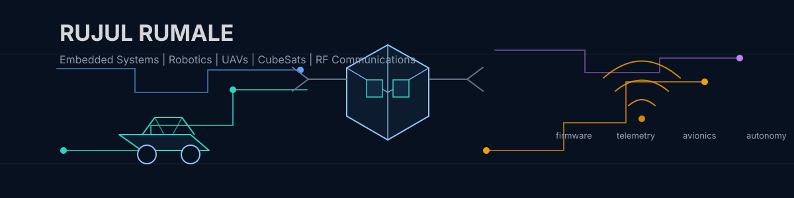
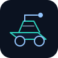
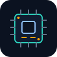

  

<h1 align="center">Rujul Rumale</h1>

  <strong>Electronics and Communication Engineering student</strong> 
  Embedded systems, robotics, UAVs, CubeSats, RF communications, PCB design, autonomous systems, and embedded AI.

  
  

## About

I build and study systems where firmware, electronics, sensing, control, and real hardware meet. My favorite problems have constraints: latency, noise, mass, power, reliability, and the fun kind of debugging where an oscilloscope earns its place on the desk.

Selected highlights:

- World Champion - WCRC CanSat World Finals
- Best Communication System Award
- Presented research at GLEX 2025
- Co-Founder, Krutrim Space Tech

## Current Focus

- Autonomous rover platform with onboard sensing, mobility control, and field testing
- UAV propulsion health monitoring using embedded data acquisition and anomaly detection
- CanSat avionics and telemetry for flight computers, RF links, and payload data
- CubeSat and space-system architecture at subsystem level
- Embedded AI for small, power-aware autonomy problems

## Engineering Domains

<table>
  <tr>
    <td align="center" width="25%">
       
      <strong>Robotics</strong> 
      rovers, sensing, control, autonomy
    </td>
    <td align="center" width="25%">
       
      <strong>Aerospace</strong> 
      CanSats, CubeSats, avionics, telemetry
    </td>
    <td align="center" width="25%">
       
      <strong>RF Systems</strong> 
      communications, link budgets, test setups
    </td>
    <td align="center" width="25%">
       
      <strong>Embedded</strong> 
      firmware, PCB bring-up, embedded AI
    </td>
  </tr>
</table>

## Tech Stack

| Area | Tools and topics |
| --- | --- |
| Firmware | C, C++, Embedded C, Python, FreeRTOS, Linux |
| Hardware | KiCad, Altium Designer, LTspice, PCB layout, schematic design, bring-up |
| Interfaces | UART, SPI, I2C, CAN, PWM, ADC, telemetry pipelines |
| Robotics | ROS 2 concepts, sensor fusion, motor control, localization, field testing |
| Aerospace | CanSat avionics, CubeSat subsystems, UAV systems, ground-station workflows |
| Data and AI | NumPy, OpenCV, MATLAB, embedded inference, anomaly detection |

## Featured Projects

These are the project lanes I would keep polished and pinned for embedded, robotics, aerospace, and defense-focused reviewers.

| Project | What it shows |
| --- | --- |
| Autonomous Rover Platform | Embedded control, mechanical integration, sensor fusion, terrain testing |
| UAV Propulsion Health Monitoring | DAQ design, telemetry, signal analysis, predictive maintenance thinking |
| CanSat Avionics and Telemetry | Flight computer design, RF communication, payload data handling |
| CubeSat Avionics Lab | Subsystem architecture, fault-aware thinking, mission-style documentation |
| RF Telemetry Toolkit | Link-budget work, communication reliability, measurement discipline |
| Embedded AI Experiments | TinyML-style models, edge inference, constrained compute awareness |

Suggested repositories to pin:

- `autonomous-rover`
- `uav-propulsion-health-monitoring`
- `cansat-avionics-telemetry`
- `cubesat-avionics-lab`
- `rf-telemetry-toolkit`
- `embedded-ai-experiments`

## Research Interests

- Robust avionics for CanSat and CubeSat missions
- RF telemetry, antenna-aware communication, and link-budget analysis
- UAV propulsion monitoring and fault detection
- Autonomous navigation for rover and UAV platforms
- Embedded AI for onboard perception, diagnostics, and decision support
- PCB design for compact, testable, field-ready systems

## GitHub Statistics

  
  

## Contact

I am interested in embedded systems, robotics, aerospace, defense technology, and research-heavy hardware roles.

- GitHub: [Rujul-Rumale](https://github.com/Rujul-Rumale)
- Email: [rujul.rumale@gmail.com](mailto:rujul.rumale@gmail.com)

